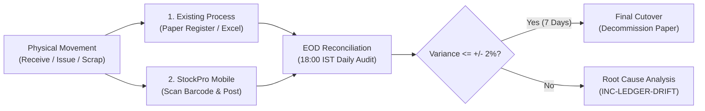

# Pilot Plant Parallel-Running & Cutover Plan

**Governing Standard:** `docs/phases.md` § Phase 7  
**Exit Criteria:** One manufacturing facility runs a full week of real operations in the app with counts reconciling to ±2% of physical ledger before paper/spreadsheet processes are retired.

---

## 1. Objectives & Principles

1. **Zero Stock Halts:** Manufacturing line operations cannot be paused or disrupted by software cutover.
2. **Dual-Entry Integrity:** For the 14-day pilot window, both the existing system (paper bincards / Excel register) and StockPro are updated for every physical movement.
3. **Daily EOD Variance Audit:** Every evening at 18:00 IST, the Store Keeper and Inventory Manager reconcile physical balances between the two systems.
4. **Authoritative Cutover:** Complete transition occurs only after 7 consecutive calendar days with variance ≤ ±2%.

---

## 2. 14-Day Dual-Entry Protocol

### Day 1–3: Shadow Entry
- Store Keepers record movements on paper as primary, followed immediately by scanning and posting into StockPro.
- Systems architect on-site to assist with scanner ergonomics and network edge cases.

### Day 4–7: Primary Mobile Entry
- Store Keepers use StockPro as primary on the shop floor.
- Backup clerks transcribe end-of-shift summaries into the legacy spreadsheet.
- Daily reconciliation discrepancy reports logged in `/launch/reconciliation_logs/`.

### Day 8–14: Sign-Off & Cutover Window
- Measure 7 consecutive days of discrepancy data.
- If variance ≤ ±2% across all 1,250 items, Plant Manager and Org Admin sign the official Cutover Certificate.
- Paper registers archived to plant compliance records; StockPro declared the sole system of record.
