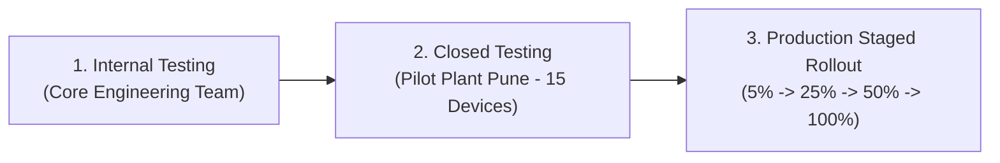

# Google Play Staged Rollout & Release Management Strategy

**Standard:** `docs/phases.md` § Phase 7, `docs/architecture.md` §10.4  
**Target:** 0.0% critical Crashlytics rate, < 0.1% non-fatal error rate.

---

## 1. Release Tracks Progression

### Track 1: Internal Testing Track (Day 1)
- Distribution: Direct email to 5 core engineering & QA members.
- Validation: End-to-end smoke test, Camera barcode scanning, offline queue drain, and token revocation.

### Track 2: Closed Testing Track (Day 2–7)
- Distribution: Pilot Plant (Pune) Store Keepers, Supervisors, and Plant Manager (15 named testers).
- Dual-entry operation alongside paper bincards.

---

## 2. Production Staged Rollout Protocol

Every staged rollout increment requires a **mandatory 24-hour observation window** in Google Play Console and Firebase Crashlytics before escalating:

| Stage | Rollout % | Observation Window | Stability Exit Gates | Escalation Action |
|---|---|---|---|---|
| **Phase A** | **5%** | 24 Hours | Crash-free sessions ≥ 99.8%, 0 ANRs, 0 outbox migration errors | Escalate to 25% |
| **Phase B** | **25%** | 24 Hours | Crash-free sessions ≥ 99.5%, p95 latency < 2.0s | Escalate to 50% |
| **Phase C** | **50%** | 24 Hours | No unresolved ledger drift alerts | Escalate to 100% |
| **Phase D** | **100%** | Continuous | Ongoing operational monitoring | Full Production State |

---

## 3. Rollout Halt & Abort Triggers

Halt rollout immediately via **Google Play Console → Releases → Halt Rollout** if any of the following occur during the 24-hour observation:
1. Crash-free sessions drop below 99.5%.
2. Any crash in Room database schema migration or `StockProDatabase_Impl`.
3. Outbox drain failure rate > 1.0%.
4. Severe camera scanner ANR on shop-floor rugged devices.

*Upon halting rollout, refer immediately to `docs/runbooks/rollback_app_release.md`.*
